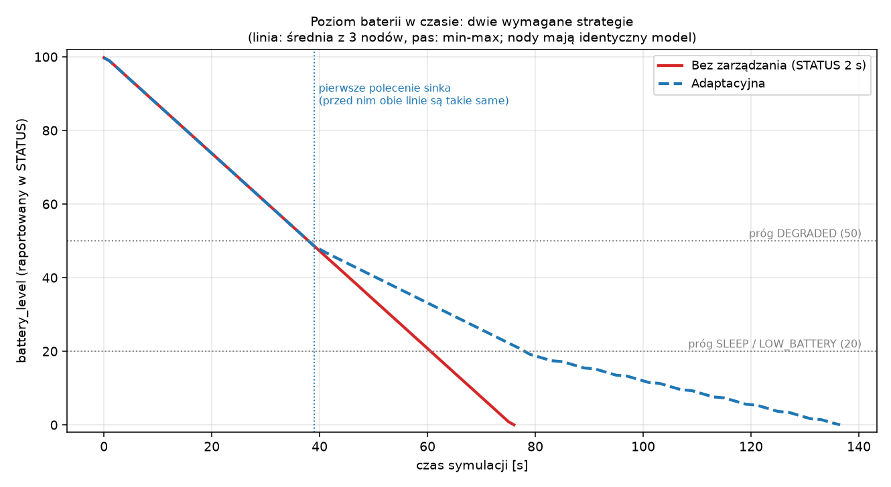
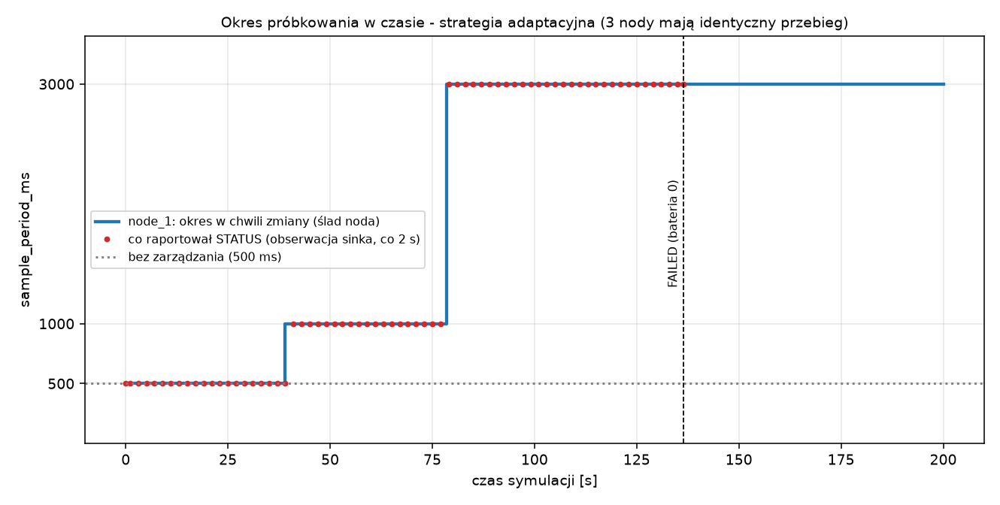

# Laboratorium WSN – Grupa 1: zarządzanie energią i cyklem pracy

Sieć sensoryczna: **3 procesy `node` + 1 `sink-manager`**, komunikacja **UDP na `127.0.0.1`**, komunikaty w JSON.
Sink obserwuje stan nodów (STATUS, ALERT), podejmuje decyzję zarządczą, wysyła potwierdzane polecenia `CONFIG`
(ACK / ERROR, timeout i ponowienie tego samego `command_id`) i rejestruje skutki w dzienniku.
Tylko biblioteka standardowa Pythona; `matplotlib` jest potrzebny wyłącznie do wykresów (`analyze.py`).

## 1. Uruchomienie

```bash
cd wsn_lab
python3 -m venv .venv && .venv/bin/pip install matplotlib       # raz (tylko do wykresów)

# A) WSZYSTKO jedną komendą (ok. 5 min): 13 przebiegów + tabela + wykresy
.venv/bin/python run_all.py

# B) jeden eksperyment (te same 4 procesy co w instrukcji)
.venv/bin/python run_experiment.py --sink config/sink_adaptacyjna.json --out wyniki/moj_test

# C) cztery osobne terminale (jak w instrukcji); wartości `--time-scale 1` są ważne, patrz niżej
.venv/bin/python sink_manager.py --config config/rdzen/sink.json --output-dir wyniki/reczny --time-scale 1 --grace-s 12   # terminal 1, najpierw
.venv/bin/python node.py --config config/rdzen/node_1.json --output-dir wyniki/reczny --time-scale 1                      # terminal 2
.venv/bin/python node.py --config config/rdzen/node_2.json --output-dir wyniki/reczny --time-scale 1                      # terminal 3
.venv/bin/python node.py --config config/rdzen/node_3.json --output-dir wyniki/reczny --time-scale 1                      # terminal 4

# D) testy (51) i test mutacyjny
.venv/bin/python -m unittest -v test_wsn
.venv/bin/python mutation_check.py                               # -> wyniki/mutacje.txt
```

**Tryb ręczny (C).** Konfiguracje w `config/rdzen/` mają zgodne czasy (sink i nody po 40 s). Zero czasu eksperymentu sinka
to pierwszy odebrany komunikat, a nody startują, kiedy je uruchomisz. Dlatego w trybie ręcznym użyj `--time-scale 1`
(przy 10 każda sekunda opóźnienia między terminalami to 10 s symulacji) i uruchom nody w ciągu kilku sekund po sinku;
`--grace-s 12` daje sinkowi czas na końcowe STATUS spóźnionych nodów. Tryb sprawdzono ze startami co ok. 2 s.
Wyniki całego opracowania pochodzą z `run_experiment.py` / `run_all.py` (te same 4 procesy, startowane razem).

**Przyspieszenie symulacji.** Instrukcja dopuszcza przyspieszenie: `time_scale = 10` oznacza, że 1 s symulacji trwa 0,1 s
rzeczywistej. Wszystkie okresy i progi (500 ms, 2 s, 6 s…), czasy życia i czasy w tabelach/wykresach są w **czasie
symulacji**, **z wyjątkiem opóźnienia obsługi polecenia i czasu niespójności konfiguracji**, które są mierzone zegarem
i podawane w **ms rzeczywistych** (opóźnienie UDP nie zależy od przyspieszenia). Tabele mają to zaznaczone w nagłówkach
(`[ms rzecz.]` / `[s sym.]`).

## 2. Pliki

| Plik / folder | Rola |
|---|---|
| `wsn_common.py` | kontrakt komunikatów, **walidacja CONFIG**, kontrola typów pól, energia w liczbach całkowitych, zegar symulacji |
| `node.py` | node: pomiary (sinusoida + szum), STATUS, ALERT, energia, maszyna stanów, obsługa CONFIG |
| `sink_manager.py` | odbiór, **tabela stanu sinka**, polecenia, timeouty/ponowienia, strategia adaptacyjna, dziennik |
| `run_experiment.py` | uruchamia 4 procesy dla jednego eksperymentu |
| `run_all.py` | odtwarza wszystkie przebiegi i analizę jedną komendą (`--tylko-analiza` pomija symulacje) |
| `analyze.py` | metryki, tabele i wykresy wyłącznie z zapisanych plików |
| `mutation_check.py` | test mutacyjny (celowe błędy w kopii kodu) -> `wyniki/mutacje.txt` |
| `test_wsn.py` | 51 testów (jednostkowe + 2 integracyjne z prawdziwymi procesami UDP) |
| `config/node_{1,2,3}.json`, `config/sink_*.json` | konfiguracje eksperymentów głównych (200 s, `time_scale` 10) |
| `config/rdzen/`, `config/strat/` | konfiguracje testów: wspólny rdzeń (40 s) i ścieżka ze stratami (80 s) |
| `config/wariant_B/` | wariant kosztu SLEEP do analizy wrażliwości |
| `wyniki/<przebieg>/` | `management_log.csv`, `status_log.csv`, `data_log.csv`, `state_table.csv`, `run_meta.json`, `<node>_truth.json`, `<node>_energy_trace.csv`, `metrics.json` |
| `wyniki/tabela_wynikow.md`, `wyniki/wykres_*.png`, `wyniki/mutacje.txt` | wyniki zbiorcze |

Każdy plik `config/sink_*.json` zawiera `node_configs` (które trzy nody uruchamia `run_experiment.py`) oraz parametry
eksperymentu (`duration_s`, `time_scale`, progi, okresy, scenariusz); parametry nodów (energia, okresy, sygnał) są w
`config/node_*.json`. Nic z eksperymentów nie jest „ukryte” we flagach.

## 3. Kontrakt komunikatów

`DATA`, `STATUS`, `CONFIG`, `ACK`, `ERROR`, `ALERT` mają pola z instrukcji, bez dodatkowych. Sink odrzuca komunikat z
brakującym polem **albo z polem o złym typie** (np. `status_sequence` jako tekst) i liczy go jako uszkodzony.

**Typ `COMMAND` nie jest używany.** Wszystkie zmiany (okres próbkowania, okres STATUS, tryb pracy) idą przez `CONFIG`
z `parameter` ∈ {`sample_period_ms`, `status_period_ms`, `operating_state`}; instrukcja wymienia `COMMAND` na diagramie,
ale nie definiuje jego formatu. Zakresy: `sample_period_ms` 100–5000 ms włącznie; `status_period_ms` 500–20000 ms
(zakres nasz); `operating_state` tylko `ACTIVE`/`DEGRADED`/`SLEEP`. Powody `ERROR`: `VALUE_OUT_OF_RANGE`,
`INVALID_VALUE_TYPE`, `UNKNOWN_PARAMETER`, `INVALID_STATE_VALUE`, `WRONG_DESTINATION`, `STALE_CONFIG_VERSION`,
`MALFORMED_COMMAND`, `NODE_NOT_READY`, `NODE_NOT_OPERATIONAL`.

## 4. Stany

```text
STARTING ──(startup_ms)──► ACTIVE ◄──► DEGRADED ◄──► SLEEP        (zmiany tylko poleceniem sinka)
   dowolny stan pracy ──(bateria = 0)──► FAILED  (ostatni STATUS "FAILED", potem cisza)
   dowolny stan pracy ──(koniec eksperymentu)──► STOPPED
```

Sink przechowuje dwa **różne** stany: `reported_state` i `observed_state`. `UNREACHABLE` jest wyłącznie stanem
**obserwowanym** (brak STATUS dłużej niż timeout) i nie nadpisuje `reported_state`. Node, który nigdy nie przysłał
STATUS, też zostaje `UNREACHABLE` (cisza liczona od startu eksperymentu). `STOPPED` jest zapowiedzianym końcem pracy,
więc nie jest niedostępnością.

## 5. Mechanizmy wspólne – jak zrealizowane

| Wymaganie | Realizacja |
|---|---|
| STATUS co 2 s | `status_period_ms` w konfiguracji noda; sink może go zmienić poleceniem |
| UNREACHABLE po 6 s | **odstępstwo od instrukcji (świadome):** timeout = `max(6 s, 3 × status_period)`, żeby po wydłużeniu okresu STATUS sink sam nie wywołał fałszywego alarmu. Domyślnie okres STATUS wynosi 2 s, więc timeout to dokładnie 6 s. Ścisłe 6 s włącza `"adaptive_timeout": false` w konfiguracji sinka (test `test_stala_wartosc_timeoutu_gdy_adaptacja_wylaczona`). W wariancie z rzadszym STATUS w SLEEP wykrycie awarii trwa przez to 18 s |
| Polecenia sinka | `CONFIG`, najwyżej jedno polecenie w locie na node; kolejne czekają w kolejce |
| Walidacja → ACK/ERROR | `validate_config()` (czysta funkcja) **przed** jakąkolwiek zmianą |
| Unikatowy `command_id` | `cmd_001`, `cmd_002`… (globalny licznik sinka) |
| Duplikat nie wykonuje się ponownie | node pamięta odpowiedź na każdy `command_id` i odsyła ją bez ponownego wykonania |
| `config_version` | startuje od 1; rośnie dopiero po poprawnym wykonaniu; niesie ją każdy `DATA`, `STATUS` i `ACK` |
| Timeout polecenia | `command_timeout_ms` = 1000 ms sym., do 3 ponowień **tego samego** `command_id`, potem `COMMAND_TIMEOUT … GAVE_UP` |
| Odtwarzanie konfiguracji | gdy node zgłasza starszą wersję bez polecenia w locie, sink ponawia ostatni zamiar nowym poleceniem, **maks. 3 razy**, potem `RESTORE_GAVE_UP` (głuchy node nie jest bombardowany bez końca) |
| Tabela stanu | pola `observed_state`, `reported_state`, `last_status_ns`, `battery_level`, `sample_period_ms`, `expected_/reported_config_version`, `pending_command_id`; plik `state_table.csv` |

Tabela jest aktualizowana **wyłącznie** po komunikatach UDP. Wysłanie `CONFIG` zmienia tylko
`expected_config_version` (zamiar sinka); `sample_period_ms` i `reported_state` zmieniają się dopiero po ACK/STATUS.
Błąd w obsłudze jednego komunikatu (`HANDLER_ERROR` w dzienniku) nie zatrzymuje sinka.

**Zmiana trybu to dwa polecenia (nie jest atomowa).** Instrukcja dopuszcza w `CONFIG` jeden `parameter`, więc sink
wysyła najpierw `operating_state`, a po jego ACK `sample_period_ms`; każde podnosi `config_version` (stąd 12 poleceń na 3
nody × 2 zmiany trybu × 2). Jeśli drugie zginie, node chwilowo ma nowy stan i stary okres; kolejny STATUS to ujawnia,
a strategia ponawia brakujący zamiar nowym `command_id` (test `test_zmiana_trybu_samonaprawa_po_utracie_drugiego_polecenia`).

### Dziennik `management_log.csv`

Kolumny dokładnie wg instrukcji. Zdarzenia: `STATUS_RECEIVED`, `ALERT_RECEIVED`, `NODE_UNREACHABLE`, `COMMAND_SENT`,
`ACK_RECEIVED`, `ERROR_RECEIVED`, `COMMAND_TIMEOUT`, `CONFIG_MISMATCH`, `CONFIG_RESTORED` oraz pomocnicze:
`NODE_REACHABLE`, `STRATEGY_DECISION` (decyzja z obserwowanym poziomem baterii), `RESTORE_SCHEDULED`, `RESTORE_GAVE_UP`,
`MISMATCH_OPEN_AT_END`, `HANDLER_ERROR`. W `details`: `response_ms=` i `duration_ms=` (**ms rzeczywiste**),
`silence_sim_ms=` (ms symulacji, jak timeout), `duplicate_ack`, `duplicate_error`, `cause=…`.
`CONFIG_MISMATCH` otwiera okres `expected_config_version != reported_config_version`, `CONFIG_RESTORED` go zamyka
(`cause=ack_received`, `version_reported_by_node` lub `rollback_after_error`).

## 6. Model energii i założenia

```text
battery_level początkowo 100.0;  generowanie pomiaru 0.10;  wysłanie DATA 0.50;
wysłanie STATUS 0.25;  odebranie polecenia 0.10;  cykl SLEEP 0.01
```

Koszty są w `config/node_*.json` (sekcja `energy`). Reguły adaptacyjne (`config/sink_adaptacyjna.json`, decyzje
podejmuje **sink** z obserwowanej baterii): `> 50` ACTIVE/500 ms, `20 < b ≤ 50` DEGRADED/1000 ms, `≤ 20` SLEEP/3000 ms.

Instrukcja jest w kilku miejscach niejednoznaczna. Przyjęte założenia (wszystkie są w konfiguracji albo w kodzie):

1. **Cykl SLEEP – dwie interpretacje.** *Wariant A (domyślny):* w SLEEP node dalej mierzy i wysyła co 3000 ms (tak mówi
   reguła adaptacyjna), a cykl kosztuje 0,01 **ponad** zwykły koszt pomiaru i wysyłki (0,61 na pomiar). *Wariant B:*
   cykl SLEEP **zastępuje** koszt pomiaru i wysyłki (0,01 na cykl). Wariant B jest w `config/wariant_B/` i opisany w
   analizie wrażliwości (pkt 8) – wniosek o opłacalności strategii zależy od tej interpretacji.
2. **Co kosztuje, a co nie.** Kosztują: każdy pomiar (0,10), każdy DATA (0,50), **każdy STATUS (0,25), także pierwszy
   (STARTING) i końcowy (STOPPED)**, każde odebrane polecenie (0,10, także duplikat), cykl SLEEP. **Nie kosztują**
   (instrukcja ich nie wycenia): wysłanie ACK, ERROR i ALERT oraz **ostatni STATUS „FAILED”** nadawany przy baterii 0
   (martwy node „wydaje ostatnie tchnienie”, bo nie ma już energii, żeby ją odjąć).
3. **STATUS w SLEEP** jest wysyłany tak samo często (co 2 s) – to ważne dla pytań 3 i 4.
4. **Bateria 0 ⇒ FAILED.** Instrukcja nie mówi, co się dzieje przy 0; bez tego bateria byłaby ujemna.
5. **`sent_packets` w STATUS** = liczba wysłanych pakietów `DATA`; **`sequence`** i **`config_version`** startują od 1.
6. **ALERT `LOW_BATTERY`** jest wysyłany raz, gdy bateria po raz pierwszy osiągnie `≤ 20`.
7. **Energia w liczbach całkowitych** (jednostki 0,001) – na floatach `100 − 500·0,1` nie daje równo `50.0`, a progi
   `> 50` i `≤ 20` są ostre (`test_arytmetyka_calkowita_zamiast_float`).
8. **Czas reakcji** liczymy od **pierwszego** wysłania polecenia do odbioru ACK, na zegarze sinka.
9. **Dostępność** = czas, gdy node jest osiągalny **i** raportuje ACTIVE/DEGRADED/SLEEP, / czas eksperymentu.
10. **Narzut zarządzania** = (STATUS + CONFIG + COMMAND + ACK + ERROR + ALERT, z ponowieniami i duplikatami) /
    (to samo + DATA) – wszystkie pakiety widziane przez sink w obu kierunkach.
11. **Zero czasu eksperymentu** sinka to pierwszy odebrany komunikat; po `duration_s` sink czeka jeszcze `grace_s`
    (3 s sym.) na końcowe STATUS.

Koszt energii **na jeden pomiar** (wariant A, STATUS co 2 s): ACTIVE 0,66 (0,6 + 0,25·0,5/2),
DEGRADED 0,725, SLEEP 0,985. Rzadsze próbkowanie nie obniża więc kosztu pomiaru – obniża **tempo** zużycia.

## 7. Testy sprawdzające rdzeń i ścieżki błędów

### 7.1 Test wspólnego rdzenia (kroki 1–8 z instrukcji)

`config/rdzen/sink.json`, przebieg `wyniki/test_rdzenia/` (czasy w s symulacji). Wartości dobrano tak, żeby ponowne
wykonanie duplikatu **było widoczne**: gdyby node wykonał stary `cmd_003` drugi raz, okres wróciłby z 2000 do 1500.

| t | Polecenie sinka (node_1) | Zdarzenia w `management_log.csv` |
|---|---|---|
| 8 | `sample_period_ms=1000` | `cmd_001` → `ACK APPLIED`, `config_version 1→2` |
| 14 | `sample_period_ms=50` (poza zakresem) | `cmd_002` → `ERROR VALUE_OUT_OF_RANGE`, wersja nadal 2 (sink cofa `expected` do 2) |
| 20 | **ten sam** `cmd_002` jeszcze raz | `duplicate_test_resend` → `ERROR_RECEIVED … duplicate_error` |
| 24 | `sample_period_ms=1500` | `cmd_003` → `ACK APPLIED`, wersja 3 |
| 28 | `sample_period_ms=2000` | `cmd_004` → `ACK APPLIED`, wersja 4 |
| 32 | **ten sam** `cmd_003` (stary duplikat) | `ACK_RECEIVED … duplicate_ack`; node **nie** cofa okresu do 1500 |

Wynik (z `node_1_truth.json` i `state_table.csv`): `commands_applied = 3`, `duplicates_ignored = 2`,
`config_version = 4`, okres w tabeli sinka **2000 ms**; node_2 i node_3 bez zmian (wersja 1); sink odebrał tyle `DATA`, ile
nody wysłały. Automatycznie: `test_wsn.TestIntegracja.test_rdzen_ack_error_duplikat`.

### 7.2 Test ze stratami (timeout, ponowienia, `GAVE_UP` na prawdziwym UDP)

Na localhost UDP prawie nie gubi pakietów, więc w zwykłych przebiegach nie ma timeoutów. `config/strat/` włącza haki
testowe: **node_1** gubi 40 % poleceń i 40 % odpowiedzi, a **node_3 jest głuchy** (gubi 100 % poleceń); generator
losowy z ziarnem, więc przebieg jest powtarzalny. Sink wysyła 8 poleceń do node_1 i 1 do node_3.

| Przebieg | Wysłane polecenia | ACK | ERROR | Skuteczność (ACK/wysłane) | COMMAND_TIMEOUT | GAVE_UP | Duplikaty zignorowane przez nody | Czas reakcji: średnia / maks [ms rzecz.] |
|---|---:|---:|---:|---:|---:|---:|---:|---|
| test_rdzenia | 4 | 3 | 1 | 75.0 % | 0 | 0 | 2 | 0.4 / 0.5 |
| test_strat | 12 | 8 | 0 | 66.7 % | 29 | 4 | 5 | 227.6 / 322.3 |

W `wyniki/test_strat/`: node_1 po wielu `COMMAND_TIMEOUT` i ponowieniach tego samego `command_id` zastosował każde
polecenie najwyżej raz (duplikaty po zgubionym ACK odrzucone, `config_version = 1 + liczba wykonanych`). Dla głuchego
node_3 sink po 3 ponowieniach kończy `GAVE_UP`, próbuje odtworzyć konfigurację maksymalnie 3 razy i zapisuje
`RESTORE_GAVE_UP`; wersja node_3 zostaje 1. Gdy ACK zginął, a node zgłosił już nową wersję w `DATA`/`STATUS`,
`CONFIG_RESTORED` ma `cause=version_reported_by_node`. Test: `test_stratny_node_ponowienia_bez_podwojnego_wykonania`.

## 8. Wyniki wariantu Grupy 1

Eksperymenty: 200 s symulacji, `time_scale = 10`, trzy nody o identycznym modelu. Wszystkie liczby pochodzą z
`wyniki/*/` przez `analyze.py`. Przebiegi: **Bez zarządzania** (stale ACTIVE, 500 ms) i **Adaptacyjna** (progi 50/20) –
dwie strategie wymagane w instrukcji – oraz warianty do pytań 3–5 i do analizy wrażliwości: rzadszy STATUS w SLEEP,
priorytet node_1 (progi 30/10 tylko dla node_1), wariant B kosztu SLEEP, STATUS co 1 s i co 4 s bez zarządzania.

### Tabela wyników (wymagana w instrukcji)

Okno 100 s symulacji – ten sam czas obserwacji dla wszystkich strategii (średnia z 3 nodów):

| Strategia | Energia końcowa | Pomiary odebrane | Pomiary wygenerowane | Zmiany trybu | Czas ACTIVE [s] | Czas DEGRADED [s] | Czas SLEEP [s] | Narzut | Czas życia do FAILED [s] | Czas do poziomu 20 [s] | Dostępność |
|---|---:|---:|---:|---:|---:|---:|---:|---:|---:|---:|---:|
| Bez zarządzania (STATUS 2 s) | 0.0 | 151 | 151 | 0 | 75.0 | 0.0 | 0.0 | 21.4 % | 76.0 | 61.0 | 75.0 % |
| Adaptacyjna | 12.4 | 124 | 124 | 2 | 38.0 | 39.5 | 21.5 | 32.6 % | — | 78.5 | 99.0 % |
| Adaptacyjna + rzadszy STATUS w SLEEP | 14.0 | 124 | 124 | 2 | 38.0 | 39.5 | 21.5 | 30.7 % | — | 78.5 | 99.0 % |
| Adaptacyjna + priorytet node_1 | 9.2 | 129 | 129 | 2 | 42.7 | 35.7 | 20.6 | 31.7 % | — | 74.5 | 99.0 % |
| Adaptacyjna, wariant B kosztu SLEEP | 16.6 | 124 | 124 | 2 | 38.0 | 39.5 | 21.5 | 32.6 % | — | 78.5 | 99.0 % |
| Bez zarządzania, STATUS 1 s | 0.0 | 138 | 138 | 0 | 68.5 | 0.0 | 0.0 | 34.3 % | 69.5 | 55.5 | 68.5 % |
| Bez zarządzania, STATUS 4 s | 0.0 | 158 | 158 | 0 | 78.5 | 0.0 | 0.0 | 12.7 % | 79.5 | 64.0 | 78.5 % |

Do końca eksperymentu (200 s). Przy większości strategii baterie są wtedy wyczerpane, więc „energia końcowa” = 0 i
porównanie opiera się na **czasie życia** i liczbie pomiarów:

| Strategia | Energia końcowa | Pomiary odebrane | Pomiary wygenerowane | Zmiany trybu | Czas ACTIVE [s] | Czas DEGRADED [s] | Czas SLEEP [s] | Narzut | Czas życia do FAILED [s] | Czas do poziomu 20 [s] | Dostępność |
|---|---:|---:|---:|---:|---:|---:|---:|---:|---:|---:|---:|
| Bez zarządzania (STATUS 2 s) | 0.0 | 151 | 151 | 0 | 75.0 | 0.0 | 0.0 | 21.4 % | 76.0 | 61.0 | 37.5 % |
| Adaptacyjna | 0.0 | 137 | 137 | 2 | 38.0 | 39.5 | 58.0 | 36.6 % | 136.5 | 78.5 | 67.7 % |
| Adaptacyjna + rzadszy STATUS w SLEEP | 0.0 | 143 | 143 | 2 | 38.0 | 39.5 | 78.5 | 31.2 % | 157.0 | 78.5 | 78.0 % |
| Adaptacyjna + priorytet node_1 | 0.0 | 139 | 139 | 2 | 42.7 | 35.7 | 47.8 | 34.8 % | 127.2 | 74.5 | 63.1 % |
| Adaptacyjna, wariant B kosztu SLEEP | 3.7 | 158 | 158 | 2 | 38.0 | 39.5 | 121.5 | 41.0 % | — | 78.5 | 99.5 % |
| Bez zarządzania, STATUS 1 s | 0.0 | 138 | 138 | 0 | 68.5 | 0.0 | 0.0 | 34.3 % | 69.5 | 55.5 | 34.2 % |
| Bez zarządzania, STATUS 4 s | 0.0 | 158 | 158 | 0 | 78.5 | 0.0 | 0.0 | 12.7 % | 79.5 | 64.0 | 39.2 % |

### Wykresy (z `status_log.csv` i śladu noda, czyli z zapisanych danych)

1. `battery_level` w funkcji czasu dla obu wymaganych strategii (średnia z 3 nodów i pas min–max; do pierwszego
   polecenia sinka, ok. 39 s, linie się pokrywają, bo strategie różnią się dopiero po pierwszej decyzji):
   `wyniki/wykres_bateria.png`; wszystkie warianty: `wyniki/wykres_bateria_warianty.png`.



2. `sample_period_ms` w funkcji czasu dla strategii adaptacyjnej: linia to moment faktycznej zmiany na nodzie, kropki to
   to, co raportował STATUS. Zmiana okresu jest widoczna u sinka dopiero przy kolejnym STATUS (do 2 s później):
   `wyniki/wykres_okres_probkowania.png`.



### Polecenia, narzut i wykrywanie niedostępności

| Strategia | Wysłane polecenia | ACK | ERROR | Skuteczność | Czas reakcji: średnia [ms rzecz.] | mediana [ms rzecz.] | maks [ms rzecz.] | Niespójność config [ms rzecz.] | Pakiety zarządcze | Pakiety DATA |
|---|---:|---:|---:|---:|---:|---:|---:|---:|---:|---:|
| Bez zarządzania (STATUS 2 s) | 0 | 0 | 0 | — | — | — | — | 0.0 | 123 | 453 |
| Adaptacyjna | 12 | 12 | 0 | 100.0 % | 0.56 | 0.54 | 1.10 | 6.8 | 237 | 411 |
| Adaptacyjna + rzadszy STATUS w SLEEP | 15 | 15 | 0 | 100.0 % | 0.98 | 0.98 | 2.02 | 14.7 | 195 | 429 |
| Adaptacyjna + priorytet node_1 | 12 | 12 | 0 | 100.0 % | 0.47 | 0.36 | 1.24 | 5.4 | 223 | 417 |
| Adaptacyjna, wariant B kosztu SLEEP | 12 | 12 | 0 | 100.0 % | 0.64 | 0.61 | 1.22 | 7.9 | 330 | 474 |
| Bez zarządzania, STATUS 1 s | 0 | 0 | 0 | — | — | — | — | 0.0 | 216 | 414 |
| Bez zarządzania, STATUS 4 s | 0 | 0 | 0 | — | — | — | — | 0.0 | 69 | 474 |

| Strategia | Node | FAILED w t [s sym.] | UNREACHABLE w t [s sym.] | Cisza przed wykryciem [ms sym.] | FAILED -> UNREACHABLE [s sym.] | Fałszywe UNREACHABLE (node wrócił) |
|---|---|---:|---:|---:|---:|---:|
| Bez zarządzania (STATUS 2 s) | node_1 | 76.0 | 82.1 | 6065 | 6.1 | 0 |
| Bez zarządzania (STATUS 2 s) | node_2 | 76.0 | 82.1 | 6063 | 6.1 | 0 |
| Bez zarządzania (STATUS 2 s) | node_3 | 76.0 | 82.1 | 6064 | 6.1 | 0 |
| Adaptacyjna | node_1 | 136.5 | 142.6 | 6100 | 6.1 | 0 |
| Adaptacyjna | node_2 | 136.5 | 142.6 | 6101 | 6.1 | 0 |
| Adaptacyjna | node_3 | 136.5 | 142.6 | 6108 | 6.1 | 0 |
| Adaptacyjna + rzadszy STATUS w SLEEP | node_1 | 157.0 | 175.0 | 18012 | 18.0 | 0 |
| Adaptacyjna + rzadszy STATUS w SLEEP | node_2 | 157.0 | 175.0 | 18011 | 18.0 | 0 |
| Adaptacyjna + rzadszy STATUS w SLEEP | node_3 | 157.0 | 175.0 | 18021 | 18.0 | 0 |
| Adaptacyjna + priorytet node_1 | node_1 | 108.5 | 114.7 | 6163 | 6.2 | 0 |
| Adaptacyjna + priorytet node_1 | node_2 | 136.5 | 142.6 | 6104 | 6.1 | 0 |
| Adaptacyjna + priorytet node_1 | node_3 | 136.5 | 142.6 | 6103 | 6.1 | 0 |
| Bez zarządzania, STATUS 1 s | node_1 | 69.5 | 75.6 | 6082 | 6.1 | 0 |
| Bez zarządzania, STATUS 1 s | node_2 | 69.5 | 75.6 | 6080 | 6.1 | 0 |
| Bez zarządzania, STATUS 1 s | node_3 | 69.5 | 75.6 | 6059 | 6.1 | 0 |
| Bez zarządzania, STATUS 4 s | node_1 | 79.5 | 85.6 | 6086 | 6.1 | 0 |
| Bez zarządzania, STATUS 4 s | node_2 | 79.5 | 85.6 | 6099 | 6.1 | 0 |
| Bez zarządzania, STATUS 4 s | node_3 | 79.5 | 85.6 | 6076 | 6.1 | 0 |

### Powtórzenia i rozrzut

| Strategia | Przebiegi | Pomiary odebrane (średnia z nodów) | Czas życia do FAILED [s] | Narzut [%] | Skuteczność poleceń [%] | Czas reakcji: średnia [ms rzecz.] |
|---|---:|---|---|---|---|---|
| Bez zarządzania | 3 | 151 | 76.0 | 21.4 | — | — |
| Adaptacyjna | 3 | 137 | 136.5 | 36.6 | 100.0 | 0.54–0.82 |

Model energii jest deterministyczny, więc powtórzenia dają te same wartości energii, pomiarów i czasu życia; nody w
przebiegu mają identyczny model, więc „średnia z 3 nodów” nie niesie informacji statystycznej, tylko upraszcza zapis.
Zmienia się jedynie czas reakcji (zależy od obciążenia komputera). Rozrzutu energetycznego nie da się więc pokazać bez
zmiany modelu (np. losowych kosztów), czego instrukcja nie wymaga.

### Obserwacje

- **Zużycie energii.** Bez zarządzania bateria spada o ok. 1,33 jednostki na sekundę (pomiar co 500 ms kosztuje 0,6,
  STATUS co 2 s dokłada 0,125 na sekundę) i node przechodzi w FAILED po 76 s. Strategia adaptacyjna zwalnia zużycie po
  przekroczeniu progów i przedłuża pracę do 136,5 s.
- **Decyzja na podstawie obserwacji.** Pierwsza decyzja zapada przy poziomie baterii ok. 48,8, a nie 50,0 (sink widzi
  baterię co 2 s); drugą (SLEEP) wywołuje `ALERT LOW_BATTERY` (poziom 19,85).
- **Narzut zarządzania rośnie z 21,4 % do 36,6 %** (237 pakietów zarządczych wobec 123). Same polecenia to niewiele:
  12 CONFIG + 12 ACK + 3 ALERT; resztę (210 pakietów) stanowią STATUS, które idą dalej co 2 s, podczas gdy DATA
  jest rzadsze (411 wobec 453). Narzut jest więc głównie skutkiem nieproporcjonalnie częstego STATUS w stanach
  oszczędzania, a nie samych poleceń.
- **Skuteczność poleceń 100 %**, czas reakcji średnio 0,5–1 ms rzeczywistej (maks. 2 ms). Polecenia bez strat nie ujawniają
  mechanizmów niezawodności – dlatego są testy 7.1 i 7.2, w których skuteczność wynosi 75 % i 67 %.
- **Wykrywanie niedostępności:** FAILED → UNREACHABLE trwa 6,1 s (timeout 6 s); po wydłużeniu okresu STATUS w SLEEP do 6 s
  timeout rośnie do 18 s, więc awaria jest wykrywana trzy razy później – cena oszczędzania energii na STATUS.
- **Fałszywy alarm przy przyspieszeniu (ważne ograniczenie metody).** Przy `time_scale = 10` timeout 6 s symulacji to
  zaledwie 0,6 s rzeczywistej. W jednym z przebiegów wariantu „priorytet” chwilowe zacięcie systemu (ok. 1 s) zatrzymało
  nody 1 i 2, a sink ogłosił `UNREACHABLE` i po chwili `NODE_REACHABLE` (kolumna „Fałszywe UNREACHABLE” w tabeli D).
  Zacięcie zaburzyło też zużycie energii, więc przebieg powtórzono; zanieczyszczony zachowano jako dowód w
  `wyniki/przyklad_zacinania_systemu/`. Wszystkie przebiegi w tabelach mają 0 fałszywych alarmów.

### Analiza wrażliwości: interpretacja kosztu SLEEP

Wniosek „adaptacyjna daje mniej pomiarów niż brak zarządzania” zależy od interpretacji cyklu SLEEP (pkt 6.1):

| Wariant | Pomiary do końca (200 s) | Czas życia | Energia po 200 s |
|---|---:|---:|---:|
| Bez zarządzania | 151 | 76,0 s | 0 (FAILED) |
| Adaptacyjna, wariant A (SLEEP kosztuje 0,61 + 0,01 na pomiar) | 137 | 136,5 s | 0 (FAILED) |
| Adaptacyjna, wariant B (cykl SLEEP kosztuje 0,01) | 158 | > 200 s (żyje) | 3,7 |

W wariancie A strategia kupuje czas życia za pomiary (−9 %); w wariancie B, gdzie SLEEP jest prawdziwie tani, daje
**więcej** pomiarów (+5 %) i dłuższe życie jednocześnie. Instrukcja mówi o „abstrakcyjnym modelu do porównania
strategii” – nasze wyniki pokazują, że porównanie zależy od wyceny stanu SLEEP, więc ta wycena musi być jawna.

## 9. Odpowiedzi na pytania

**1. Jak strategia wpłynęła na zużycie energii?**
Zużycie spadło po przekroczeniu progów: w oknie 100 s strategia adaptacyjna ma jeszcze 12,4 energii, a brak zarządzania 0
(node pada w 76 s). Czas życia wzrósł z 76 s do 136,5 s (+80 %), a czas do poziomu krytycznego 20 z 61 s do 78,5 s.
Ale **energia na jeden pomiar wzrosła** (0,66 w ACTIVE → 0,985 w SLEEP), bo STATUS i koszt cyklu SLEEP są stałe – oszczędza
się tempo zużycia, nie koszt pojedynczego pomiaru.

**2. Jaki był koszt oszczędzania energii w liczbie pomiarów?**
Wariant A: w oknie 100 s 124 pomiary zamiast 151 (−18 %), a do wyczerpania baterii 137 zamiast 151 (−9 %). Czyli
strategia daje dłuższą dostępność (99 % w oknie 100 s wobec 75 %), ale mniej danych. Przy innej wycenie SLEEP
(wariant B) strategia daje 158 pomiarów, więc koszt w pomiarach **zależy od modelu energii**, nie jest cechą samej
strategii (tabela w pkt 8).

**3. Czy częstszy STATUS skraca czas pracy?**
Tak, co pokazuje bezpośredni test z tą samą strategią (bez zarządzania) i różnym okresem STATUS na całym przebiegu:
STATUS co 1 s: życie 69,5 s i 138 pomiarów (narzut 34,3 %); co 2 s: 76,0 s i 151 pomiarów (21,4 %); co 4 s: 79,5 s i
158 pomiarów (12,7 %). Udział STATUS w zużyciu rośnie, gdy pomiarów jest mało: ok. 9 % przy 500 ms, ale ok. 38 % w SLEEP
(0,125 z 0,33 na sekundę). Rzadszy STATUS tylko w SLEEP wydłużył życie z 136,5 s do 157,0 s (+15 %) i dał 143 zamiast 137
pomiarów, kosztem wykrycia awarii po 18 s zamiast 6 s.

**4. Czy SLEEP powinien całkowicie wyłączać status?**
Nie. Bez STATUS sink nie odróżni uśpionego noda od uszkodzonego (zobaczy tylko `UNREACHABLE`), nie zobaczy poziomu
baterii ani `config_version` i nie zweryfikuje, że zmiana trybu zadziałała. Kompromis: rzadki STATUS w SLEEP (nasz
wariant, +15 % życia) razem z dostosowaniem timeoutu sinka (3 × okres STATUS), żeby sink nie wywołał fałszywego alarmu;
koszt to 3× dłuższe wykrywanie awarii. Pełne wyłączenie STATUS wymagałoby innego mechanizmu wykrywania niedostępności.

**5. Jak chronić dane z węzła o wysokim priorytecie?**
W tym modelu każdy node ma własną baterię, więc „wcześniejsze ograniczanie nodów o niskim priorytecie” node_1 niczego
nie daje (nie dzielą zasobów) – miałoby sens tylko przy wspólnym kanale lub kolejce (inne laboratorium). Sprawdziliśmy
niższe progi dla node_1 (DEGRADED < 30, SLEEP < 10): dostarczył 143 pomiary zamiast 137 (**+6, +4 %**), ale żył 108,5 s
zamiast 136,5 s (**−28 s, −21 %**); nody 2 i 3 bez zmian (137 pomiarów, 136,5 s). Zysk jest więc mały w stosunku do straty
w czasie życia i zasadniczo przesuwa tylko moment, w którym node_1 pada. To zmienia też charakter ochrony: nasze DATA nie
mają ACK, retransmisji ani bufora, więc zapis danych priorytetowych chroni dopiero ich niezawodność, a nie sama
częstość próbkowania: (i) ACK i retransmisja dla DATA z noda priorytetowego, (ii) lokalny bufor na czas SLEEP,
(iii) rezerwa energii przeznaczona wyłącznie na utrzymanie łączności, (iv) niższy próg SLEEP (tak jak w tym wariancie)
albo zakaz SLEEP dla tego noda. Mechanizm progów indywidualnych jest w konfiguracji sinka (`strategy.node_overrides`).

## 10. Pułapki (na AI i nie tylko) i jak je rozwiązano

Wniosek z instrukcji: kod pisany z pomocą AI łatwo „działa”, ale myli zegary, liczy duplikaty i zmienia stan przed
walidacją. Każdy punkt ma test. Testy sprawdzono także **mutacyjnie**: `mutation_check.py` celowo psuje kod w kopii
(10 mutacji) i sprawdza, czy testy to wychwycą; wynik w `wyniki/mutacje.txt` (10 z 10 wykrytych).

| Pułapka | Jak rozwiązano | Test |
|---|---|---|
| `FAILED` ≠ `UNREACHABLE` | dwie osobne kolumny tabeli; UNREACHABLE nie nadpisuje stanu raportowanego | `test_failed_raportowany_a_potem_unreachable`, `test_niedostepnosc_po_6_s_to_nie_failed` |
| Node, który nigdy się nie odezwał, zostaje „nieznany” | cisza liczona od startu eksperymentu, `never_reported` | `test_node_ktory_nigdy_sie_nie_odezwal_jest_unreachable` |
| Duplikat polecenia wykonany drugi raz | node pamięta odpowiedź na `command_id`; energia za odbiór nadal liczona | `test_duplikat_nie_jest_wykonany_ponownie`, test integracyjny (stary duplikat po nowszym poleceniu) |
| Aktualizacja konfiguracji **przed** walidacją | `validate_config()` przed `_apply()`; ERROR nie zmienia stanu ani wersji | `test_niepoprawne_polecenie_error_bez_zmiany` |
| `True`/`False` jako liczba (`isinstance(True, int)`) | `is_int()` odrzuca `bool`, `500.0` i `"500"` | `test_bool_nie_jest_poprawna_liczba`, `test_zly_typ` |
| Granice zakresu (100 i 5000 włącznie) | testy 99/100/5000/5001 | `test_granice_zakresu` |
| Progi baterii 50 i 20 na floatach | energia w liczbach całkowitych, progi `>50`, `≤20` | `test_progi_wlacznie_i_wylacznie`, `test_adaptacyjna_dokladnie_na_progach` |
| Tabela „zgaduje” skutek polecenia | po CONFIG zmienia się tylko `expected_config_version` | `test_tabela_aktualizowana_tylko_komunikatami` |
| Mieszanie zegarów / czas symulowany | jeden zegar, czas reakcji z zegara sinka i w ms **rzeczywistych**, nie z pola noda i nie × `time_scale` | `test_czas_reakcji_z_zegara_sinka_nie_z_pola_noda` |
| ERROR zostawia błędną wersję oczekiwaną | po ERROR `expected_config_version` wraca do wersji noda | `test_error_cofa_wersje_oczekiwana` |
| Stary / zdublowany STATUS i DATA | `status_sequence` i `sequence` | `test_stary_i_zdublowany_status_ignorowany`, `test_duplikat_data_to_nie_nowa_probka` |
| Zły typ pola w komunikacie zabija sink | kontrola typów + `try/except` w obsłudze; `HANDLER_ERROR` w dzienniku | `test_zle_typy_pol_nie_zabijaja_sinka`, `test_wyjatek_w_obsludze_nie_zatrzymuje_sinka` |
| Fałszywy UNREACHABLE po wydłużeniu okresu STATUS | timeout = `max(6 s, 3 × status_period)` (świadome odstępstwo, wyłączalne) | `test_timeout_dostosowany_do_okresu_status`, `test_stala_wartosc_timeoutu_gdy_adaptacja_wylaczona` |
| ALERT wysyłany wielokrotnie | flaga „już wysłany” | `test_alert_low_battery_tylko_raz` |
| Martwy node odpowiada | po FAILED node milczy, także na polecenia | `test_wyczerpanie_to_failed_i_cisza` |
| Zgubiony ACK / polecenie | timeout, ponowienie tego samego `command_id`, node nie wykonuje drugi raz | `test_ponowienie_tego_samego_command_id_i_rezygnacja`, test integracyjny ze stratami |
| Nieskończone odtwarzanie konfiguracji głuchego noda | maks. 3 próby, potem `RESTORE_GAVE_UP` | `test_odtwarzanie_konfiguracji_jest_ograniczone` |
| Częściowa zmiana trybu (drugie polecenie zginęło) | kolejny STATUS ujawnia różnicę; sink ponawia zamiar | `test_zmiana_trybu_samonaprawa_po_utracie_drugiego_polecenia` |
| `status_log` z opóźnionym stanem obserwowanym | zapis PO aktualizacji tabeli | `test_status_log_ma_stan_obserwowany_po_aktualizacji` |
| Wyścig na `next_sample_ns` między wątkami | zmiana tylko pod blokadą (wątek poleceń i pętla główna) | testy integracyjne (przebiegi bez anomalii) |
| Sink kończy przed nodami | zero czasu = pierwszy komunikat + `grace_s` | wykryte na przebiegu: pierwotnie 66 z 78 pomiarów |
| Wyniki „z pamięci”, a nie z danych | `analyze.py` czyta tylko pliki CSV/JSON | – |

## 11. Ograniczenia

- UDP na localhost praktycznie nie gubi pakietów, więc w głównych przebiegach skuteczność poleceń to 100 %; ścieżkę
  strat pokazują haki testowe (7.2).
- `DATA` nie mają ACK ani retransmisji (instrukcja tego nie wymaga).
- Energia jest abstrakcyjna; nasłuchiwanie radia nie ma kosztu, więc SLEEP „nic nie kosztuje” poza cyklem 0,01.
- Przy bardzo dużym `time_scale` (> ok. 10) zacięcia systemu dają fałszywe UNREACHABLE i zaburzają energię (pkt 8).
- Nody mają identyczny model, więc wyniki 3 nodów są niemal identyczne (patrz „Powtórzenia i rozrzut”).

## 12. Checklista z instrukcji

- [x] Uruchomiono trzy nody i sink-manager (`run_experiment.py`, `run_all.py`; tryb 4 terminali sprawdzony ręcznie).
- [x] Sink odbiera `DATA` i `STATUS` (`data_log.csv`, `status_log.csv`).
- [x] Każdy node odbiera polecenia na osobnym porcie (6101–6103).
- [x] Poprawne polecenie kończy się `ACK`; niepoprawne – `ERROR`.
- [x] Duplikat polecenia nie jest wykonywany ponownie (także po nowszym poleceniu).
- [x] Kontrola `config_version` (node, sink, okresy niespójności).
- [x] Zmierzono czas reakcji i skuteczność poleceń (także w scenariuszach ze stratami); obliczono narzut zarządzania.
- [x] Zapisano `management_log.csv` (w każdym folderze `wyniki/<przebieg>/`), z 9 wymaganymi zdarzeniami; `COMMAND_TIMEOUT`
  występuje w `wyniki/test_strat/`.
- [x] Wykonano pełny wariant grupowy (dwie wymagane strategie, analiza wrażliwości i warianty do pytań).
- [x] Wykresy powstały z zapisanych danych.
